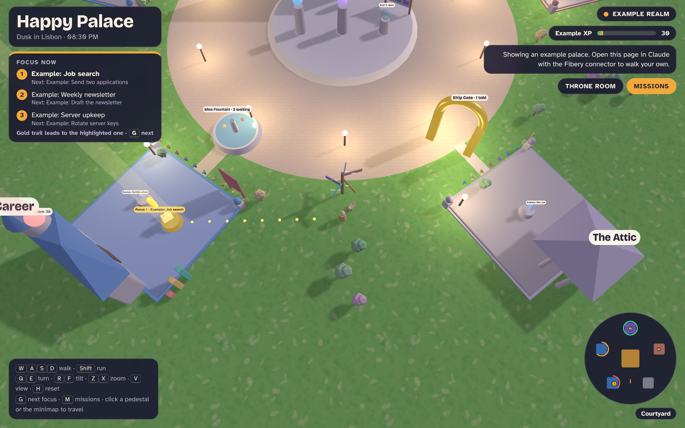
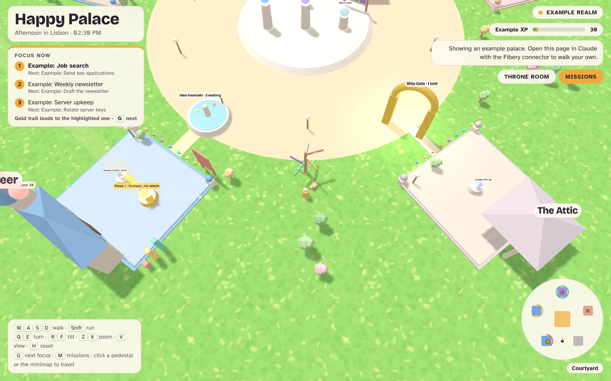

# Happy Palace

A walkable 3D world over your personal operating system.

The name is a play on two ideas: a **memory palace**, the old technique of remembering things by placing them in rooms you walk through, and a **happy place**, somewhere you actually want to go back to. Your goals, projects and missions get a place in a world you enjoy visiting, so you remember where everything is and look forward to opening it. Life areas become themed buildings, projects become glowing pedestals, your most important work is marked like a game quest, and you can finish missions from inside the world.

Built on Three.js r128. The demo runs from one HTML file with example data. The same engine runs as a [Fibery](https://fibery.io) custom app reading your live workspace, or as a Claude artifact reading a Fibery connector.



## What it does

The world answers three questions at a glance: **where should I be, how healthy is each area, and what do I do next.**

- **Wings per life area**, each with its own landmark: garden, cottage, treasury, bazaar, amphitheatre, workshop, observatory, library, guild hall or pavilion. Projects with no area land in the Attic.
- **Projects** are pedestals. Crystal size = open tasks, colour = state, halo = shipped, a small figure = it has a lead agent.
- **Focus**: the three projects holding your highest-ranked open tasks glow gold, carry a floating "!" marker and a light beam, and get a gold trail on the ground that leads you there. A "Focus now" panel lists them.
- **Quest card**: walk up to a project to see its open missions with **25-min sprint**, **Done**, **Start**, **Hand to agent** and **Open**.
- **Scorecards**: a sign at each wing's entrance, a green/amber/red beam above the landmark, metric columns sized by attainment, and flowers that grow with the score.
- **Levels**: you level up from finished tasks (10 XP) and milestones (50 XP). Each wing has its own level shown as stars, and each project gets a gold ring per milestone done.
- **Live agents**: agents working on a task stand at that project with their latest note or comment as a thought bubble. Idle agents wait in the Agent Lodge behind the throne with their plan's quota and next reset.
- **Step inside**: stand on a wing's gate pad and press `Enter` to see every project in it (milestones, open decisions, subprojects). Step into a project to walk among its milestones, task boards, decisions, subproject doors and agents. `Esc` leaves.
- **Time of day**: sky, sun, lamps and HUD follow the clock in your time zone.
- **Throne room** with your top goals, a Mission Board, an Idea Fountain, a Ship Gate that lights up when you announce something, and a pet that follows you.



## Try it

Open `demo/index.html` in a browser. It shows an "Example realm" with made-up data.

Controls: `W A S D` walk, `Shift` run, drag to turn, scroll to zoom. `Q`/`E` turn, `R`/`F` tilt, `Z`/`X` zoom, `V` cycles Close/Follow/Aerial views, `H` resets the camera, `G` next focus project, `Enter` step inside a wing or project, `Esc` leave, `M` Mission Board. Click a pedestal or the minimap to travel. Click the world first so it receives key presses.

Edit the `CONFIG` block at the top of the script for your time zone, city name and the places on the signpost.

## Use your own data

### Option 1: Fibery custom app

1. In Fibery, create a custom app (kind **view**) in your space, or ask Claude with the Fibery MCP connected.
2. Copy `fibery-app/src/*` into the app's `src/`, add `"three": "0.128.0"` to `package.json`, and upload. See [`fibery-app/README.md`](fibery-app/README.md).
3. Rename the database and field names in `fibery-app/src/palaceApi.ts` to match your workspace.

### Option 2: Claude artifact

Publish `demo/index.html` as a Claude artifact that declares the `mcp` capability with your Fibery connector (`query`, `set_state`, `update_entities`). Inside Claude the page swaps the example realm for your live data. Adjust the queries in the `Q` object to your schema.

### Option 3: any other tool

The engine only talks to two functions: `query(q)` and `write(action, input)`. Write an adapter for Notion, Airtable, Linear or a JSON export and keep the rest.

## Build it yourself with Claude

`skill/life-os-game-world/SKILL.md` is an Agent Skill that walks Claude through building this world over someone's own setup: questions to ask, how to map data to the world, the focus and quest logic, deployment targets, and the pitfalls we hit. Add the folder to your skills and ask Claude to build you a palace.

## Repo layout

```
demo/index.html              Self-contained world with example data (the source of truth)
fibery-app/src/              Fibery custom app files: engine, data adapter, HUD markup, styles
tools/build_fibery_app.py    Regenerates fibery-app/src from demo/index.html
skill/life-os-game-world/    Agent Skill for building your own
docs/                        Screenshots
```

## Credits

Inspired by Drew Proud's game-world UI for his agents. Built by Rayo ([@rmarji](https://github.com/rmarji)) with Claude, November 2026.

MIT licensed.
